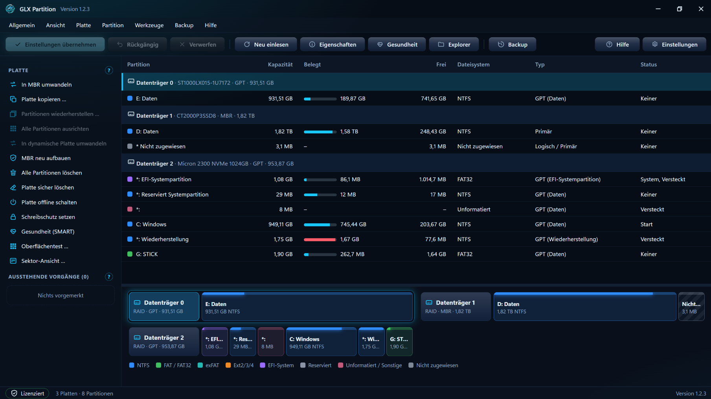
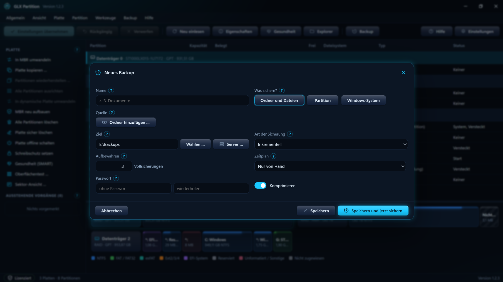
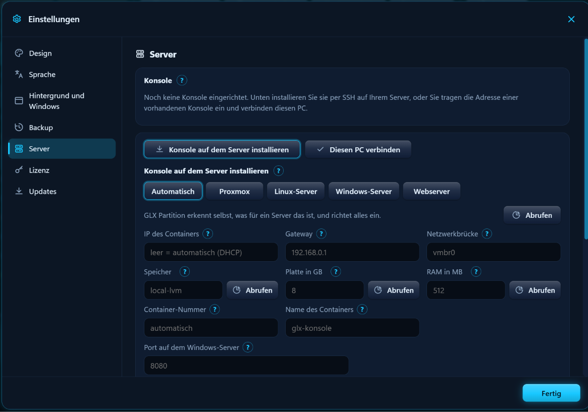
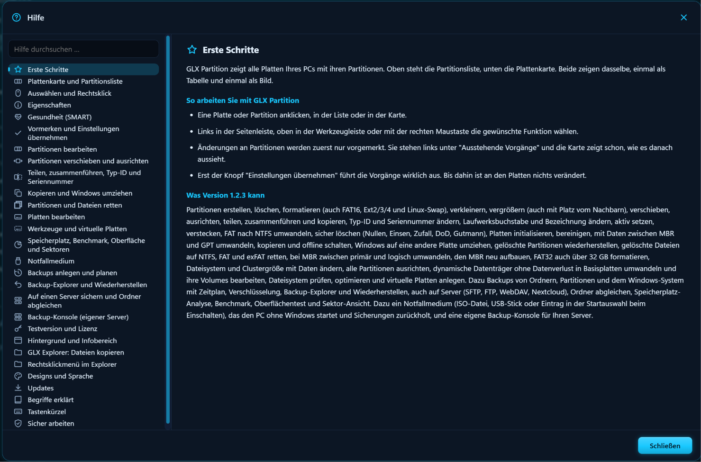
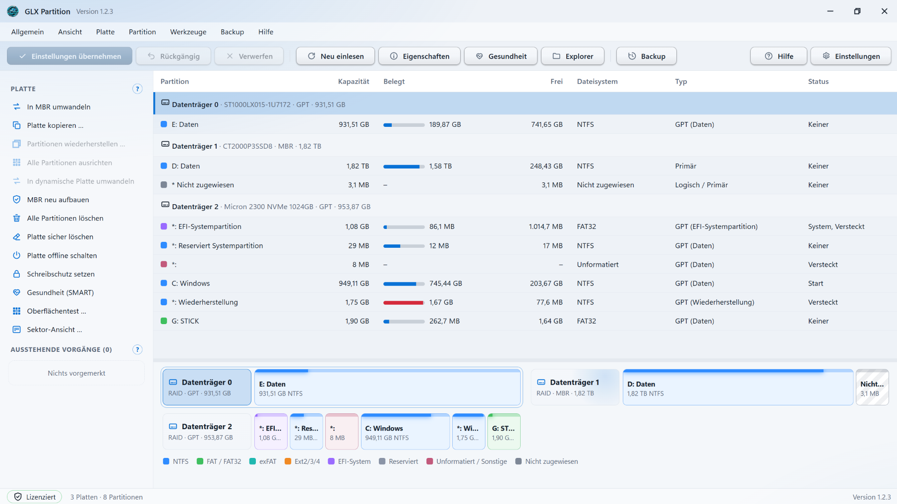
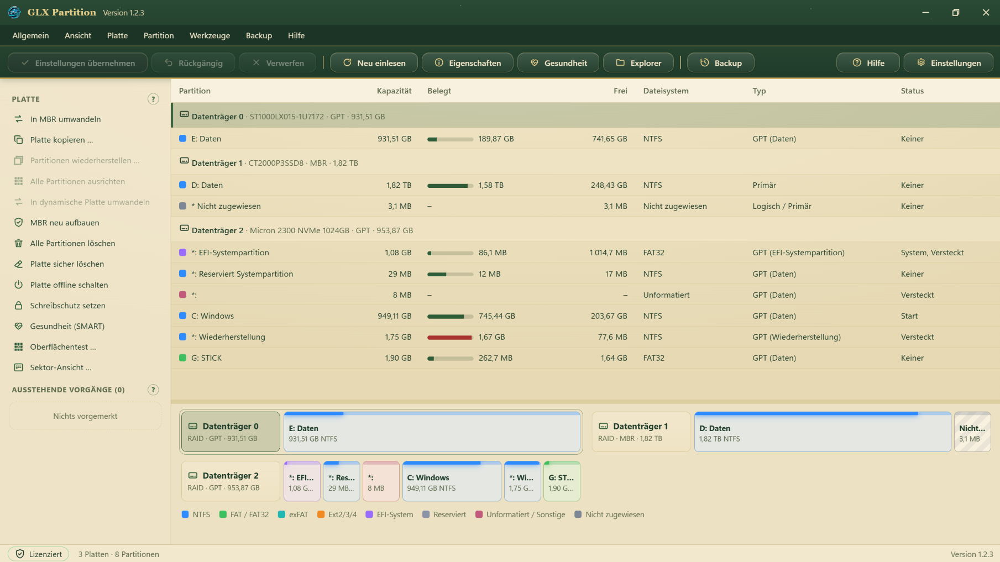

🌍 Sprachen: [🇺🇸 English](README.md) | [🇩🇪 Deutsch](README.de.md)

# 💠 GLX Partition

### Partitionen verwalten und dein System sichern.

*Verwalte Partitionen sicher mit einer Vorschau jeder Änderung und sichere oder stelle dein ganzes System wieder her.* ⚡

   

---

## ⬇️ Download

👉 Neueste Version: [Releases](../../releases/latest)  
👉 Shop und Lizenzen: [glx-tools.de](https://glx-tools.de/product/glx-partition-backup/)

---

## 📸 Überblick & Screenshots

### 1️⃣ Hauptfenster

### 2️⃣ Ansicht 2

### 3️⃣ Ansicht 3

### 4️⃣ Ansicht 4

### 5️⃣ Ansicht 5

### 6️⃣ Ansicht 6

---

## ✨ Funktionen

- 🚀 **Sicher partitionieren:** Partitionen anlegen, vergrößern, verkleinern, verschieben, zusammenführen, teilen und formatieren. Vor dem Ausführen siehst du alle Änderungen in einer Vorschau.
- 🧩 **Viele Dateisysteme:** NTFS, FAT, exFAT, Ext4 und weitere.
- ⚙️ **Datenträger verwalten:** Zwischen MBR und GPT umwandeln, Festplatten klonen, Windows auf eine SSD umziehen und dynamische Datenträger verwalten.
- 🔒 **Rettung:** Verlorene Partitionen und gelöschte Dateien wiederherstellen.
- 📂 **Verschlüsselte Sicherungen:** Vollständige, inkrementelle oder differenzielle Sicherungen mit Zeitplan und Speicherung im Netzwerk.
- ⚡ **Notfallmedium:** Bootfähiger Rettungs-USB-Stick oder ISO mit UEFI, Secure Boot und BIOS.
- 🎨 **Server und Fernwartung:** Eigene Web-Konsole für verbundene PCs, Sicherungen und Wiederherstellung aus der Ferne.
- 🌍 **Zustand der Festplatten:** SMART-Überwachung, Datenträgerprüfung und Speicheranalyse.
- 🛠️ **Virtuelle Festplatten und Schreddern:** VHD/VHDX verwalten, Festplatten sicher löschen und Ordner abgleichen.
- 📊 **14 Tage voll testen:** Alle Funktionen 14 Tage kostenlos, Deutsch und Englisch, 12 Designs.

---

## 🧩 Systemanforderungen

- Windows 10 oder Windows 11 (64 Bit)
- Administratorrechte

---

## 🧪 Testzeitraum & Lizenz

14 Tage kostenlos mit allen Funktionen, danach Lizenz über [glx-tools.de](https://glx-tools.de).

---

## 🔗 Mehr zu diesem Produkt

👉 [glx-tools.de](https://glx-tools.de/product/glx-partition-backup/)  
Support: **info@glx-tools.de**

---

## 📄 Lizenz

Copyright © 2026 GLX Tools – Gordon Lehmann. Alle Rechte vorbehalten.  
Dies ist proprietäre kommerzielle Software. Es wird keine Open-Source-Lizenz gewährt. Dieses Repository enthält nur Release-Downloads und Dokumentation; der Quelltext wird nicht veröffentlicht.

---

Mit ❤️ gemacht von **Dreamdancer100**

