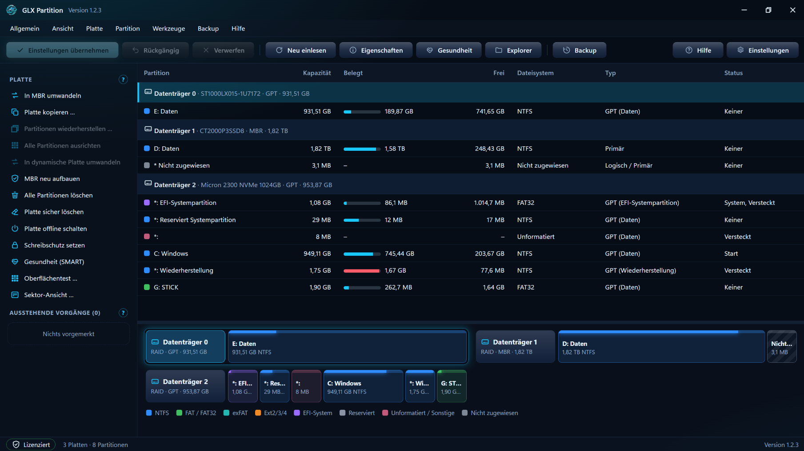
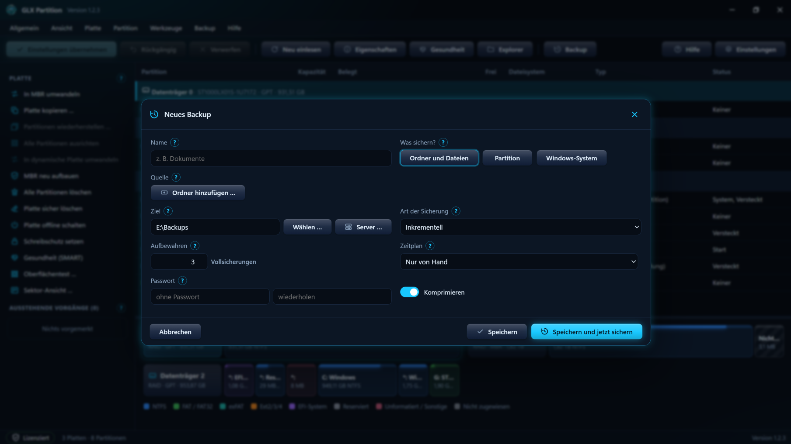
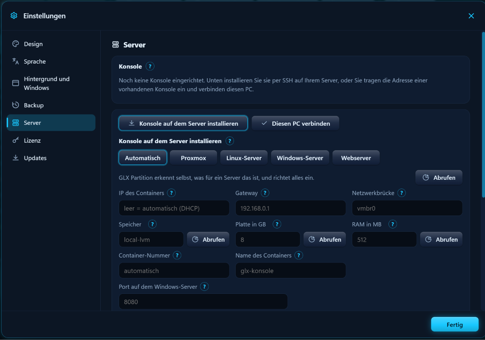
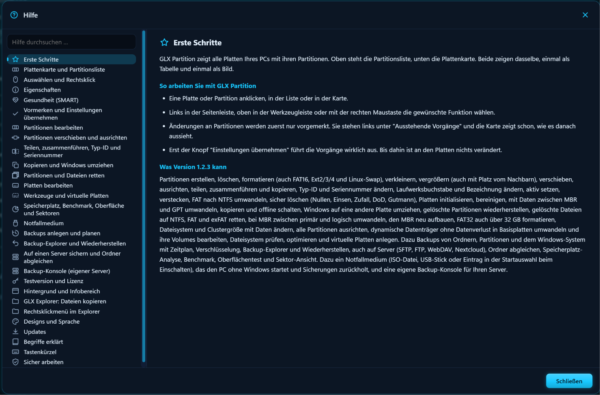
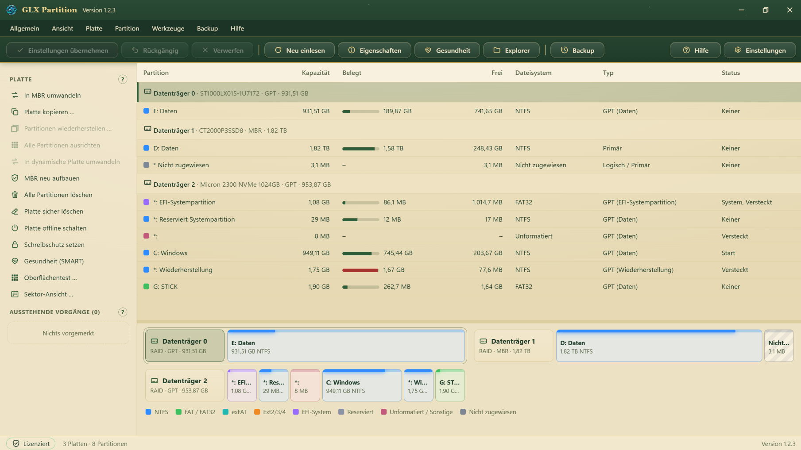

🌍 Languages: [🇺🇸 English](README.md) | [🇩🇪 Deutsch](README.de.md)

# 💠 GLX Partition

### Partition manager and backup solution.

*Manage partitions safely with a preview of every change, and back up and restore your whole system.* ⚡

   

---

## ⬇️ Download

👉 Latest version: [Releases](../../releases/latest)  
👉 Shop and licences: [glx-tools.de](https://glx-tools.de/product/glx-partition-backup/)

---

## 📸 Overview & Screenshots

### 1️⃣ Main window

### 2️⃣ View 2

### 3️⃣ View 3

### 4️⃣ View 4

### 5️⃣ View 5

### 6️⃣ View 6

---

## ✨ Features

- 🚀 **Safe partitioning:** Create, resize, move, merge, split and format partitions with a preview of all changes before applying.
- 🧩 **Many file systems:** NTFS, FAT, exFAT, Ext4 and more.
- ⚙️ **Disk management:** Convert MBR and GPT, clone disks, migrate Windows to an SSD and manage dynamic disks.
- 🔒 **Recovery:** Recover lost partitions and deleted files.
- 📂 **Encrypted backups:** Full, incremental or differential backups with scheduling and network storage.
- ⚡ **Emergency media:** Bootable USB or ISO recovery media with UEFI, Secure Boot and BIOS support.
- 🎨 **Server and remote backup:** Self-hosted web console for connected PCs, backups and remote restores.
- 🌍 **Disk health:** SMART monitoring, disk tests and storage analysis.
- 🛠️ **Virtual disks and wiping:** VHD/VHDX management, secure disk wiping and folder synchronization.
- 📊 **14-day full trial:** All features free for 14 days, German and English, 12 designs.

---

## 🧩 Requirements

- Windows 10 or Windows 11 (64-bit)
- Administrator rights

---

## 🧪 Trial & License

14 days free with all features, then a licence from [glx-tools.de](https://glx-tools.de).

---

## 🔗 More about this product

👉 [glx-tools.de](https://glx-tools.de/product/glx-partition-backup/)  
For support: **info@glx-tools.de**

---

## 📄 License

Copyright © 2026 GLX Tools – Gordon Lehmann. All rights reserved.  
This is proprietary commercial software. No open-source license is granted. This repository contains release downloads and documentation only; the source code is not published.

---

Made with ❤️ by **Dreamdancer100**

