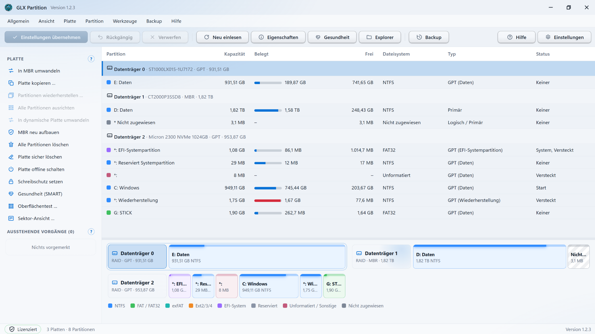

🌍 Languages: [🇺🇸 English](README.md) | [🇩🇪 Deutsch](README.de.md)

# 💠 GLX Partition

### Partition manager and backup solution.

*Manage partitions safely with a preview of every change, and back up and restore your whole system.* ⚡

   

---

## ⬇️ Download

👉 Latest version: [Releases](../../releases/latest)  
👉 Shop and licences: [glx-tools.de](https://glx-tools.de/product/glx-partition-backup/)

---

## 📖 About GLX Partition

### Look first, then apply

Every change is only queued at first and shown in the disk map right away. GLX Partition only carries it out when you click "Apply changes". So you see exactly what will happen beforehand.

### Edit partitions

Create, delete and format as NTFS, FAT32, exFAT, ReFS, FAT16, Ext2, Ext3, Ext4 or Linux swap. Resize, move and align without losing data. Extend a partition with space from its neighbour, split and merge partitions. Change file system and cluster size while the files stay. FAT32 even above 32 GB, for example for car radios, TVs and cameras. Change drive letter, label, serial number and type ID, hide partitions or set them active, convert primary partitions to logical drives and back.

### Rebuild and migrate disks

MBR to GPT and GPT to MBR, also with all data. Copy a partition or a whole disk and move Windows to a new SSD. Show and edit dynamic disks and convert them back to basic disks without data loss. Rebuild the MBR when the PC no longer starts.

### Recover when something went wrong

GLX Partition finds deleted or lost partitions and brings back deleted files on NTFS, FAT and exFAT, so on USB sticks and memory cards too.

### Emergency media

As an ISO file or straight onto a USB stick. The PC starts from it even without Windows, and GLX Partition shows the disks and restores your backups.

### Backups included

Back up folders, partitions or the whole Windows system, open files included. Full, incremental or differential, encrypted with AES-256 and compressed. Target on another disk, in the network or on a server via SFTP, FTPS, FTP, WebDAV or Nextcloud. With schedule, backup explorer and restore of single files. Plus folder sync, one-way or two-way.

### Tools

Disk health (SMART), surface test, speed test, disk space analysis and sector view. Create, attach and detach virtual disks (VHD and VHDX).

### Secure wipe

Overwrite partitions and whole disks with zeros, ones, random data, according to DoD 5220.22-M or Gutmann, so that nothing can be recovered.

### Trial and licence

14 days free with all features. After that everything stays visible, only carrying out changes needs a licence.

---

## 📸 Overview & Screenshots

### 1️⃣ Main window

### 2️⃣ View 2

### 3️⃣ View 3

### 4️⃣ View 4

### 5️⃣ View 5

### 6️⃣ View 6

---

## ✨ Features

- 🚀 **Safe partitioning:** Create, resize, move, merge, split and format partitions with a preview of all changes before applying.
- 🧩 **Many file systems:** NTFS, FAT, exFAT, Ext4 and more.
- ⚙️ **Disk management:** Convert MBR and GPT, clone disks, migrate Windows to an SSD and manage dynamic disks.
- 🔒 **Recovery:** Recover lost partitions and deleted files.
- 📂 **Encrypted backups:** Full, incremental or differential backups with scheduling and network storage.
- ⚡ **Emergency media:** Bootable USB or ISO recovery media with UEFI, Secure Boot and BIOS support.
- 🎨 **Server and remote backup:** Self-hosted web console for connected PCs, backups and remote restores.
- 🌍 **Disk health:** SMART monitoring, disk tests and storage analysis.
- 🛠️ **Virtual disks and wiping:** VHD/VHDX management, secure disk wiping and folder synchronization.
- 📊 **14-day full trial:** All features free for 14 days, German and English, 12 designs.

---

## 🧩 Requirements

- Windows 10 or Windows 11 (64-bit)
- Administrator rights

---

## 🧪 Trial & License

14 days free with all features, then a licence from [glx-tools.de](https://glx-tools.de).

---

## 🔗 More about this product

👉 [glx-tools.de](https://glx-tools.de/product/glx-partition-backup/)  
For support: **info@glx-tools.de**

---

## 📄 License

Copyright © 2026 GLX Tools – Gordon Lehmann. All rights reserved.  
This is proprietary commercial software. No open-source license is granted. This repository contains release downloads and documentation only; the source code is not published.

---

Made with ❤️ by **Dreamdancer100**

